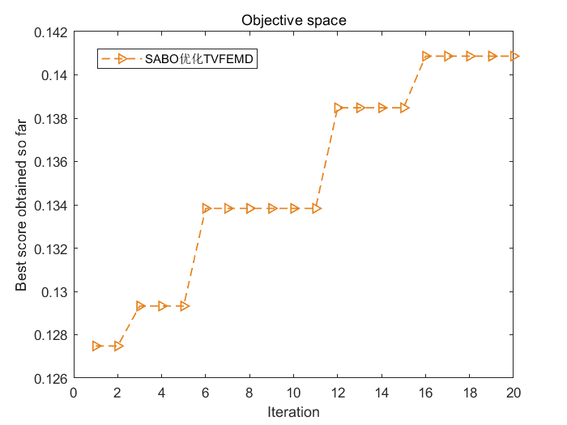
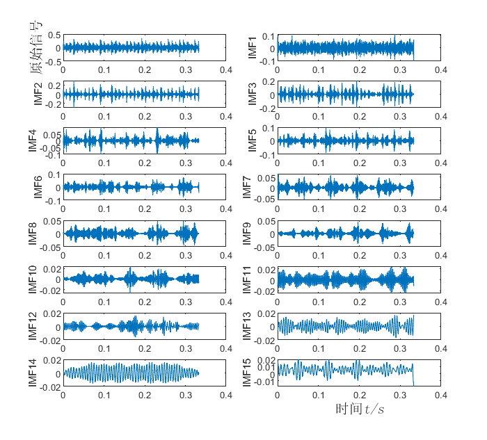
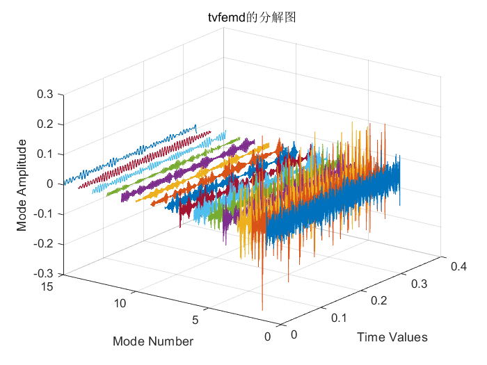
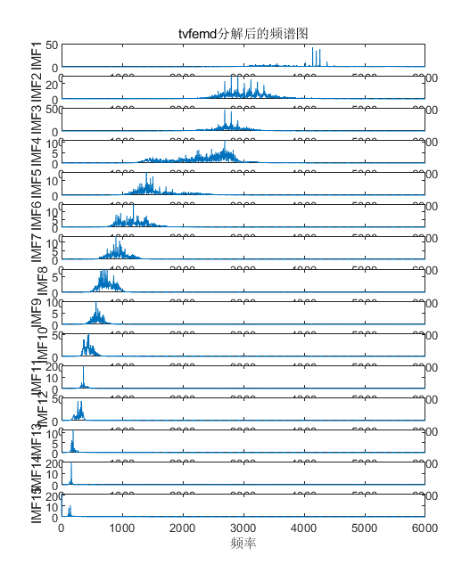
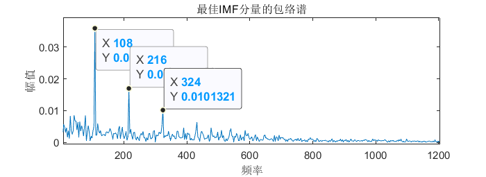
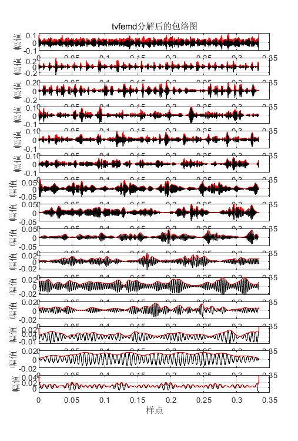
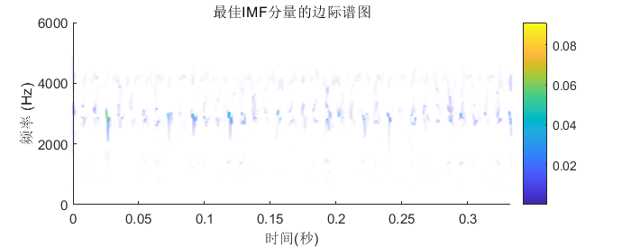

# Optimization of TVFEMD parameters by subtraction optimizer, using the envelope spectrum fault characteristic energy ratio as the fitness function

The performance of time-varying filtering empirical mode decomposition (TVFEMD) is largely dependent on the selection of its parameters (i.e., bandwidth threshold and B-spline order). In the application of TVFEMD for fault diagnosis, the parameters need to be preset manually, which makes it difficult to obtain satisfactory decomposition results.
This article has three steps:
① Utilize the subtraction optimization algorithm to search for the optimal parameter combination of TVFEMD;
② Use the best parameter combination to decompose the bearing fault signal into TVFEMD, obtaining a set of IMF.
③Select the IMF component with the maximum envelope spectrum fault characteristic energy ratio for envelope demodulation analysis, extract fault characteristics, and perform fault diagnosis.
Referenced literature is as follows:
[1] Cen Li, Zhong Xiuyou. Bearing Fault Diagnosis Based on Particle Swarm Optimization Time-Varying Filtered Empirical Mode Decomposition [J]. Machinery, 2020, 47(11)
[2] Tang Guiji, Zhou Chong, Pang Bin et al. Rotor Fault Diagnosis Based on Parameter Optimization Time-Varying Filtering Empirical Mode Decomposition [J]. Vibration and Shock, 2019, 38(10):
[3] Deng Feiyue, Tang Guiji, Wang Xiaolong. Method of Feature Extraction for Blind Faults in Bearings by Harmonic Decomposition and Self-Complementary Top-Hat Transformation [J]. Journal of Vibration Engineering, 2015, 28(06):
Taking the dataset 130.mat as an example, select the data in X130_BA_time.mat with 4000 data points. If there are no data, refer to my article on bearing diagnosis data processing in MATLAB for free code acquisition.
Briefly, the selection of fitness function here is based on the envelope spectrum fault characteristic energy ratio.
Firstly, the data is decomposed into k IMF components, and then the envelope spectrum fault characteristic energy ratio of each IMF component is calculated. The IMF component with the maximum value is selected as the optimal IMF component, and then envelope spectrum analysis can be conducted on this optimal IMF component to achieve fault diagnosis.
The definition of envelope spectrum fault characteristic energy ratio is as follows:
The envelope spectrum sequence obtained through demodulation is X, the total energy of the signal envelope spectrum is _______, and the expression for defining the fault characteristic energy ratio is as follows:
Results display
1. SABO optimized TVFEMD fitness curve graph
The program's running results will also be printed in the window:
SABO: At iteration 2 ,the best fitness is 0.12748the best position is: [0.114776           19]\nSABO: At iteration 4 ,the best fitness is 0.12933the best position is: [0.1           9]\nSABO: At iteration 6 ,the best fitness is 0.13383the best position is: [0.1           10]\nSABO: At iteration 8 ,the best fitness is 0.13383the best position is: [0.1           10]\nSABO: At iteration 10 ,the best fitness is 0.13383the best position is: [0.1           10]\nSABO: At iteration 12 ,the best fitness is 0.13848the best position is: [0.100404           12]\nSABO: At iteration 14 ,the best fitness is 0.13848the best position is: [0.100404           12]\nSABO: At iteration 16 ,the best fitness is 0.14087the best position is: [0.10921           9]\nSABO: At iteration 18 ,the best fitness is 0.14087the best position is: [0.10921           9]\nSABO: At iteration 20 ,the best fitness is 0.14087the best position is: [0.10921           9]\nBesttvfemdParameters are: 0.10921           9, BestIMFQuantity is: IMF2\n2.BesttvfemdDecomposition diagram after parameter rewinding:   
3. Display of 3D decomposition diagram:
4. Spectral graph after back-propagation with optimal TVFEMD parameters:
5. Envelope spectrum graph of the optimal IMF component after back-propagation with optimal TVFEMD parameters:
It is evident that the double, triple, and quadruple frequencies are very clear, thus it can be determined that this fault signal is an outer ring fault.
6. Envelope diagram after TVFEMD decomposition:
7. Marginal spectrum graph of the optimal IMF component:
Code directory display:
Partial code display:
%% The fault characteristic energy ratio is used as the fitness function, and SABO algorithm is adopted to optimize tvfemd, so as to obtain the optimal two parameters of tvfemd.\nclear\nclc\nclose all\naddpath(genpath(pwd))\nload 130.mat   % Here, select 130.mat\nL = 4000 ;   % Select 4000 points\ndata=X130_BA_time(2001:L+2000);% To remove transients, data is slightly shifted back\ndata = data';\nfobj=@fitness; %Fitness function\nD=2;             % Optimize the number of variables\nlb=[0.1 5];      % The lower limit, which is the bandwidth threshold and the B-spline order.\nub=[1 30];        % Upper limit value\n% Zhang et al. suggest a bandwidth threshold for the TVFEMD algorithm [0,1]. However, the value of , is closer to 0, the algorithm calculates\n% The longer the time, the better. Typically, when the value is around 0.1, the decomposition has already achieved a good effect and has a relatively short calculation time.\n% Therefore, the scope of parameter optimization in this paper is bandwidth threshold [0.1, 1], and B-spline order n is 5≤n≤30.\n% References: [1] Bearing Fault Diagnosis Based on Particle Swarm Optimization Time-Varying Filtered Empirical Mode Decomposition\n% References: [2] Zhang X, Liu Z, Miao Q, et al. An optimized time varying filtering based empirical mode decomposition method with grey wolf\n% optimizer for machinery fault diagnosis[J].Journal of Sound Vibration,2018(418):55-78.\n% References: [3] Tang Guijie, Zhou Zong, Pang Bin, et al. Rotor Fault Diagnosis Based on Parametric Optimization Time-Varying Filtering Empirical Mode Decomposition [J]. Vibration and Impact, 2019, 38(10): 162-168.\n​\nT=20;       % Maximum number of iterations\nN=15;        % Population size\nfcf = 3.5848*1796/60;  % Since it is necessary to calculate the fault characteristic energy ratio, it is required to know in advance the frequency of fault characteristics.\n% This is the fault characteristic frequency of 130.mat, and this value should also be replaced each time data is changed.\n%Specific reference: https://zhuanlan.zhihu.com/p/420780043\n[SABOBest_score,SABOBest_pos,Bestidx,SABO_curve] = SABO(N,T,lb,ub,D,fobj,data,fcf);\ndisplay(['BesttvfemdParameters are: ', num2str([SABOBest_pos(1),fix(SABOBest_pos(2))]),', BestIMFQuantity is: IMF',num2str(Bestidx)]);  % Output the best location\nsave result.mat SABOBest_score SABOBest_pos Bestidx SABO_curve\n​  

## Images

<!-- PAYMENT_BLOCK -->

## Get this dataset

- Payment link (Stripe): [Buy now](https://buy.stripe.com/3cs8yP7sY87d0vu9AB)
- Payment QR code: 

<!-- /PAYMENT_BLOCK -->
